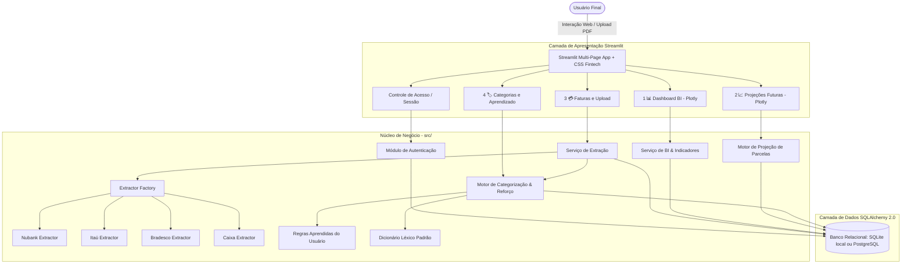
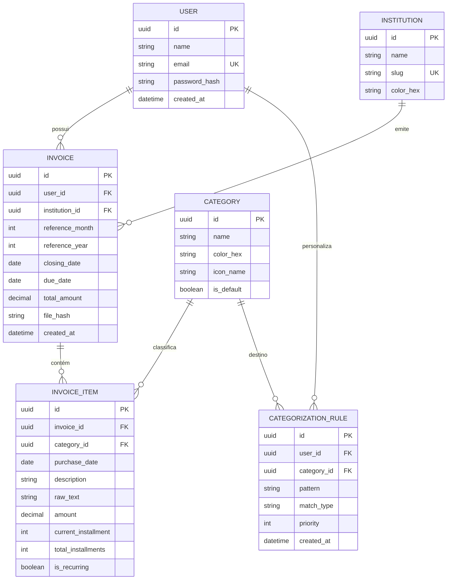

# Documento de Arquitetura de Software (ARCHITECTURE.md)

> **Status:** Planta Baixa Aprovada (Stack Unificada Python)  
> **Dono:** Arquiteto de Software & Soluções  
> **Versão:** 1.1 (Revisada com Streamlit + CSS + Plotly)  
> **Data:** 17/11/2026

---

## 1. Visão Geral da Arquitetura

O sistema é concebido como uma aplicação de inteligência financeira unificada em **Python 3.12+**, combinando processamento analítico de dados, motor de extração de PDFs com padrão *Strategy*, motor de categorização com aprendizado por reforço e persistência relacional com uma camada de visualização rica em **Streamlit + CSS customizado + Plotly**.

Essa abordagem garante execução 100% local, alta performance, zero dependência de runtimes externos (Node.js/npm) e recursos avançados de BI interativo (zoom, tooltips detalhadas, exportação de gráficos e edição de dados em tempo real).



---

## 2. Stack Tecnológica Oficial e Versões

| Componente | Tecnologia | Versão | Justificativa |
| :--- | :--- | :--- | :--- |
| **Linguagem Principal** | Python | 3.12+ / 3.14 | Ecossistema completo e maduro para processamento de PDFs, manipulação de dados e BI. |
| **Interface & BI (Frontend)** | Streamlit + CSS Customizado | 1.38+ | Interface reativa, componentes de dados ricos (`st.data_editor`), upload nativo e execução sem Node/npm. |
| **Gráficos & BI Interativo** | Plotly | 5.24+ | Gráficos interativos executivos (donut chart, barras empilhadas, linhas de projeção com hover detalhado). |
| **Manipulação de Dados** | Pandas | 2.2+ | Agregação temporal rápida, pivots e cálculo de projeções de parcelamento. |
| **Processamento de PDF** | pdfplumber / pypdf | Recentes | Extração vetorial posicional precisa de texto e tabelas para os layouts dos 4 emissores. |
| **ORM & Migrations** | SQLAlchemy 2.0 + Alembic | 2.0+ / 1.14+ | Portabilidade transparente entre SQLite (modo local zero-config) e PostgreSQL (modo container). |
| **Banco de Dados** | SQLite (dev/local) ou PostgreSQL 16 (docker) | 3 / 16 | Suporte flexível: execução sem dependências externas ou orquestrada com isolamento multiusuário. |
| **Segurança & Hashing** | passlib / bcrypt + python-dotenv | Recentes | Armazenamento seguro de credenciais com isolamento estrito de dados por `user_id`. |
| **Containers & Deploy** | Docker & Docker Compose | 28+ / v2.39+ | Execução local isolada e reprodutível com um único comando. |

---

## 3. Estrutura Oficial de Diretórios

```text
leitor_fatura_cartao/
├── .agent/                    # Regras e workflows dos agentes
├── docs/                      # Documentação de produto, arquitetura e tarefas
│   ├── PRD.md
│   ├── ARCHITECTURE.md
│   └── TASKS.md
├── docker-compose.yml         # Orquestração do ambiente completo (App + DB)
├── Dockerfile                 # Container unificado da aplicação Streamlit
├── Makefile                   # Comandos facilitadores de automação
├── requirements.txt           # Dependências Python unificadas
├── .env.example               # Exemplo de configuração de variáveis de ambiente
├── alembic.ini                # Configuração de migrations do banco
├── migrations/                # Versionamento de schema de banco (Alembic)
│   └── versions/
├── app.py                     # Ponto de entrada da aplicação Streamlit
├── assets/                    # Identidade visual e estilização
│   └── styles.css             # CSS customizado executivo (Fintech Dark/Light)
├── pages/                     # Telas do Streamlit
│   ├── 1_📊_Dashboard_BI.py
│   ├── 2_📈_Projecoes_Futuras.py
│   ├── 3_💳_Faturas_e_Upload.py
│   └── 4_🏷️_Categorias_e_Regras.py
└── src/                       # Núcleo de Domínio e Lógica de Negócio (100% desacoplado)
    ├── __init__.py
    ├── core/                  # Configurações globais e segurança
    │   ├── __init__.py
    │   ├── config.py
    │   ├── security.py        # Hashing de senhas e autenticação de sessão
    │   └── database.py        # Conexão e Sessão do SQLAlchemy
    ├── models/                # Entidades do Banco de Dados (ORM)
    │   ├── __init__.py
    │   ├── user.py
    │   ├── institution.py
    │   ├── invoice.py
    │   ├── invoice_item.py
    │   ├── category.py
    │   └── categorization_rule.py
    ├── services/              # Serviços de Negócio
    │   ├── __init__.py
    │   ├── auth_service.py    # Login, cadastro e verificação de usuário
    │   ├── categorizer.py     # Motor de categorização e aprendizado por reforço
    │   ├── analytics.py       # Agregação de KPIs e cálculos históricos
    │   ├── projections.py     # Motor preditivo de parcelas futuras
    │   └── extractors/        # Extratores especializados de PDF (Strategy Pattern)
    │       ├── __init__.py
    │       ├── base.py        # BaseInvoiceExtractor abstrato
    │       ├── factory.py     # ExtractorFactory (emissor -> extrator)
    │       ├── nubank.py
    │       ├── itau.py
    │       ├── bradesco.py
    │       └── caixa.py
    └── ui/                    # Componentes reutilizáveis de interface Streamlit
        ├── __init__.py
        ├── charts.py          # Geradores de gráficos Plotly estilizados
        ├── metrics.py         # Cards de KPI com CSS
        └── tables.py          # Renderização e edição com st.data_editor
```

---

## 4. Contratos de Dados & Interfaces de Serviço

Mesmo utilizando o Streamlit como interface unificada, a camada `src/services/` opera com contratos estritos de entrada e saída, permitindo testes unitários automatizados e desacoplamento total da UI.

### 4.1 Interface dos Extratores (`src/services/extractors/base.py`)

```python
class ExtractedItemDTO:
    purchase_date: date
    description: str
    amount: float
    current_installment: int | None
    total_installments: int | None
    raw_text: str

class ExtractedInvoiceDTO:
    institution_slug: str
    reference_month: int
    reference_year: int
    closing_date: date | None
    due_date: date
    total_amount: float
    items: list[ExtractedItemDTO]

class BaseInvoiceExtractor(ABC):
    @abstractmethod
    def extract(self, pdf_file: BytesIO) -> ExtractedInvoiceDTO:
        """Extrai metadados e lançamentos da fatura em PDF."""
        pass
```

### 4.2 Motor de Categorização e Aprendizado (`src/services/categorizer.py`)

* **Fluxo de Inferência:**
  1. Verifica se existe uma regra personalizada em `categorization_rules` para o usuário e estabelecimento. Se existir, aplica com prioridade 1.
  2. Caso contrário, consulta o dicionário léxico pré-carregado (ex: "IFOOD" $\rightarrow$ Alimentação).
  3. Não encontrando correspondência, classifica como "Outros".
* **Aprendizado por Reforço:**
  - Quando o usuário altera a categoria de um lançamento através da tabela (`st.data_editor`), o serviço salva uma nova `CategorizationRule` vinculada ao `user_id`.
  - Todas as faturas processadas no futuro aplicarão automaticamente a nova preferência do usuário.

### 4.3 Motor Preditivo de Gastos Futuros (`src/services/projections.py`)

* **Algoritmo de Projeção:**
  1. Consulta todos os itens de fatura com `total_installments > 1` do usuário.
  2. Para cada compra identificada:
     - Identifica a última fatura processada contendo essa compra (parcela $P$ de $N$).
     - Calcula as parcelas restantes: $R = N - P$.
     - Gera lançamentos projetados para os meses subsequentes $M+1, M+2, \dots, M+R$ com o respectivo valor da parcela.
  3. Agrupa por mês e categoria, gerando o montante comprometido e a lista detalhada de compromissos futuros.

---

## 5. Modelo Lógico de Dados (ERD)


